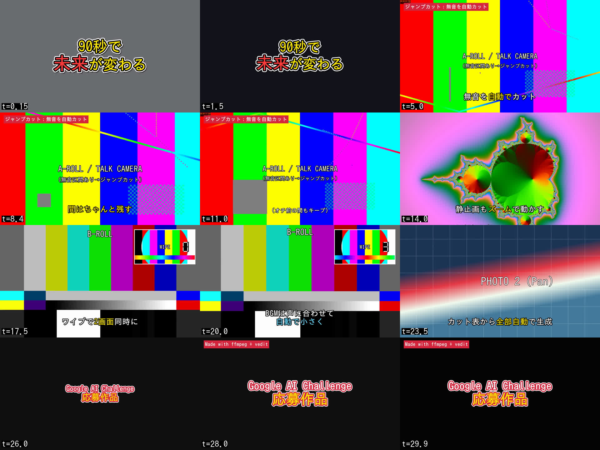
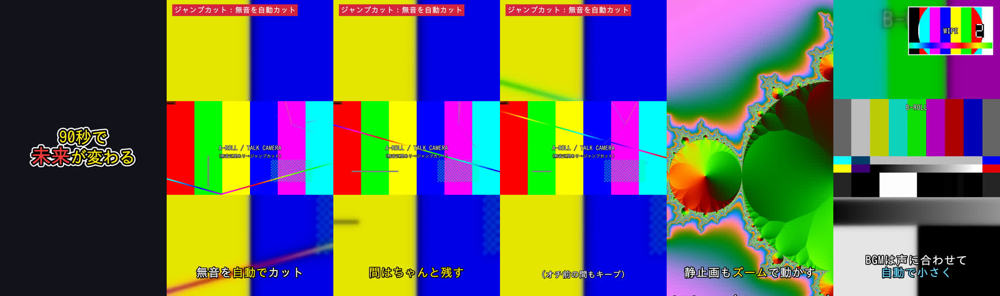
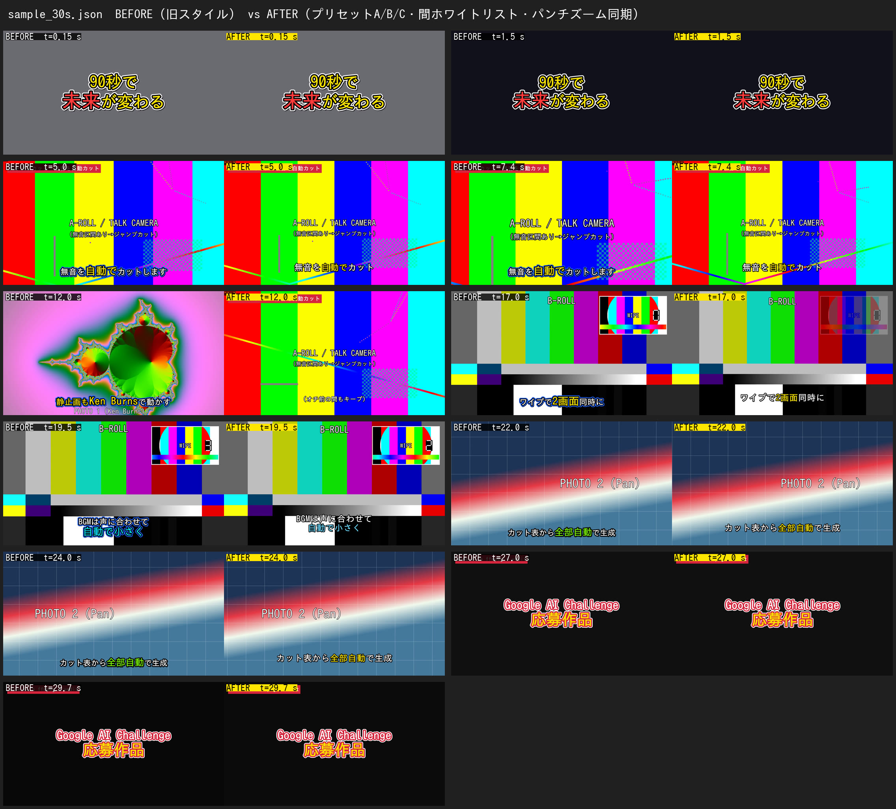

# challenge-video-editor (vedit)

Google AI Challenge 応募用の 90 秒動画を、**カット表（台本データ）から ffmpeg で自動編集・書き出し**するパイプラインです。
動画編集ソフトでの手作業をやめて、「カット表を直す → コマンド 1 発で再レンダリング」で何度でも同じ結果を再現できるようにすることが目的です。

- 入力: カット表 (JSON または CSV)
- 出力: テロップ・効果・BGM・効果音入りの MP4 1 本 (16:9 1080p。`--aspect 9:16` で縦動画に切り替え)
- 依存: **ffmpeg (libass 付き) と Python 3.10 以降だけ**です。pip / npm パッケージは使っていません（標準ライブラリのみ）

> **2026-11-01 更新**: 仕様「人気YouTuberの編集の型」に合わせて、テロッププリセット A/B/C、ジャンプカットの「残す間」ホワイトリスト、パンチズームと強調テロップの同期、仕様値のダッキングを追加しました → [§6.6](#66-編集の型プリセット仕様人気youtuberの編集の型2026-11-01) / ビフォーアフター: [`docs/before_after/sample_30s_before_after.jpg`](docs/before_after/sample_30s_before_after.jpg)




---

## 目次
1. [セットアップ](#1-セットアップ)
2. [クイックスタート（サンプル動画の作り方）](#2-クイックスタートサンプル動画の作り方)
3. [実行コマンド](#3-実行コマンド)
4. [カット表の書式 (JSON)](#4-カット表の書式-json)
5. [カット表の書式 (CSV)](#5-カット表の書式-csv)
6. [編集技術と実装方法](#6-編集技術と実装方法)
7. [テストレンダリング結果](#7-テストレンダリング結果)
8. [仕組み・ファイル構成](#8-仕組みファイル構成)
9. [素材と著作権について](#9-素材と著作権について)

---

## 1. セットアップ

| 必要なもの | 確認コマンド | 備考 |
|---|---|---|
| ffmpeg / ffprobe 4.4 以降 (6.x で動作確認) | `ffmpeg -filters \| grep -E " (ass\|zoompan\|sidechaincompress\|silencedetect) "` | **libass が有効**なビルドが必要 (`ass` フィルタ) |
| Python 3.10 以降 | `python3 --version` | 標準ライブラリのみ |
| 日本語フォント | `fc-list :lang=ja` | プリセット A/B/C は 源ノ角ゴシック / Noto Sans CJK JP Black / M PLUS Rounded 1c を探し、無ければ `IPAGothic`（擬似太字）で代替（§6.6） |

```bash
# Ubuntu / Debian
sudo apt-get install -y ffmpeg fonts-ipafont-gothic
# (任意) より太いテロップ向けフォント
sudo apt-get install -y fonts-noto-cjk-extra
```

```bash
# macOS (Homebrew)
brew install ffmpeg
```

- ダミー素材生成で使う `flite`（ffmpeg 内蔵の英語 TTS）は無くても動きます（トーン音で代用）。
- フォントは `project.font` でフォント名を指定します。手元の `.ttf/.otf` を使う場合は `project.fonts_dir` にフォルダを指定してください（例: `"fonts_dir": "fonts"`）。

## 2. クイックスタート（サンプル動画の作り方）

```bash
python3 tools/make_dummy_assets.py
```

```bash
python3 -m vedit render examples/sample_30s.json
```

これで `out/sample_30s.mp4`（30 秒、1920x1080）ができます。`make` が使える環境なら `make sample` でも同じです。

1 行目でテスト用の素材を **ffmpeg だけで生成**します（外部ダウンロードはありません）。出力先は `examples/assets/` です。

| ファイル | 内容 | 用途 |
|---|---|---|
| `talk.mp4` | testsrc2 + 合成音声。文の間に 0.6〜1.6 秒の無音あり | 話者カメラ / ジャンプカット |
| `broll.mp4` | SMPTE カラーバー + 440Hz | B ロール |
| `wipe.mp4` | 小さいテストパターン | ワイプ (PiP) |
| `photo1.png` / `photo2.png` | 4K のマンデルブロ集合 / グラデーション+グリッド | Ken Burns / パン |
| `nar_*.wav` | flite による英語ナレーション | ナレーション |
| `bgm.wav` | sine 波で合成したコード進行 (C-Am-F-G) + キック、32 秒 | BGM (ループ再生) |
| `se_pop.wav` / `se_whoosh.wav` / `se_impact.wav` | sine 波・ノイズで合成 | 効果音 |

その他のサンプル:

```bash
python3 -m vedit render examples/sample_30s.json --aspect 9:16
```

```bash
python3 -m vedit render examples/sample_30s.csv --preview
```

```bash
python3 -m vedit render examples/template_90s.json
```

それぞれ、縦動画版 `out/sample_30s_9x16.mp4`、CSV 版の 540p プレビュー、本番用 90 秒構成テンプレート `out/challenge_90s.mp4` を出力します。

## 3. 実行コマンド

```
python3 -m vedit render <カット表.json|.csv> [オプション]

  -o, --output PATH   出力 MP4 (省略時は project.output。カット表のあるフォルダ基準)
  --aspect RATIO      16:9 / 9:16 / 1:1 / 4:5 にアスペクト比を上書き (出力名に _9x16 などが付く)
  --project PATH      CSV 用のプロジェクト設定 JSON (省略時は <csv名>.project.json を自動で読む)
  --preview           540p・高速設定で試し書き出し
  --dry-run           レンダリングせず、タイムライン計算と ASS 字幕の生成だけ行う (書式チェックに便利)
  --keep-temp         中間ファイル (カットごとのセグメント、telops.ass) を out/.work_<名前>/ に残す
  -v, --verbose       実行した ffmpeg コマンドをすべて表示
```

出力されるファイル:

| ファイル | 内容 |
|---|---|
| `out/<名前>.mp4` | 完成動画 (H.264 High / AAC 192k / +faststart / -14 LUFS) |
| `out/<名前>.render.log` | 実行ログ (カットごとの長さ、ジャンプカットで何秒削ったか、所要時間) |
| `out/<名前>.render.json` | 結果 (成功/失敗、長さ、解像度、タイムライン) |
| `out/<名前>.ass` | 焼き込んだテロップの ASS 字幕 (Aegisub などで微調整の確認用) |

失敗した場合は終了コード 1 で、`{"status": "failed", "error": ...}` を出力します。

単体テスト (ffmpeg 不要の部分):

```bash
python3 -m unittest discover -s tests
```

## 4. カット表の書式 (JSON)

全体の形は次のとおりです。完全な例は [`examples/sample_30s.json`](examples/sample_30s.json) と [`examples/template_90s.json`](examples/template_90s.json) を見てください。

```jsonc
{
  "project": { ... 動画全体の設定 ... },
  "cuts": [ { ... カット1 ... }, { ... カット2 ... } ]
}
```

ファイルパスはすべて **カット表のあるフォルダからの相対パス** で書きます。

### 4.1 project（全体設定）

| キー | 既定値 | 説明 |
|---|---|---|
| `title` | `"untitled"` | MP4 のメタデータに入るタイトル |
| `aspect` | `"16:9"` | `16:9` / `9:16` / `1:1` / `4:5` |
| `resolution` | `1080` | 短辺の px (16:9 なら 1920x1080、9:16 なら 1080x1920) |
| `fps` | `30` | フレームレート |
| `target_duration` | なし | 目標秒数 (例 `90`)。0.5 秒以上ずれると警告 |
| `font` / `fonts_dir` | `"IPAGothic"` / なし | テロップの既定フォント、フォントフォルダ |
| `output` | `"out/output.mp4"` | 出力先 |
| `video` | `{"crf": 20, "preset": "medium"}` | x264 の設定 |
| `audio` | `{"loudnorm": true, "target_lufs": -14}` | 2 パスのラウドネス正規化 (YouTube 推奨の -14 LUFS) |
| `bgm` | なし | BGM とダッキングの設定 (下記) |
| `styles` | 組み込み 6 種 + プリセット A/B/B_warn/C/C_light | テロップのスタイル定義 (下記、プリセットは §6.6) |
| `se_library` | なし | SE の名前→ファイル (例 `{"pop": "assets/se_pop.wav"}`)。プリセット A の「SE ポップ」で使う |
| `cut_types` | `normal` / `hook` / `title` | カットのプリセット (下記) |
| `defaults` | 下記 | `fit`、`jumpcut` の既定値、`narration_tail` (ナレーション後の余白 0.35 秒) |
| `overrides` | なし | アスペクト比ごとの上書き (下記) |

**bgm**

```json
"bgm": {
  "file": "assets/bgm.wav",   // 短い素材は自動でループする
  "volume": 0.4, "fade_in": 0.5, "fade_out": 2.0,          // volume / ducking は省略すると仕様値 (§6.6)
  "ducking": { "enabled": true, "threshold": 0.05, "ratio": 4, "attack": 12.5, "release": 300, "makeup": 1 }
}
```

**overrides**（縦動画への切り替え）: `overrides["9:16"]` の中身は、`--aspect 9:16` のとき（または `aspect` が `9:16` のとき）に project へ deep-merge されます。`cuts` キーを書けばカット ID ごとの上書きもできます。

```json
"overrides": {
  "9:16": {
    "styles": { "default": { "size": 64, "margin_v": 330 } },
    "cuts":   { "talk": { "fit": "blur" },
                "broll": { "pip": { "source": "assets/wipe.mp4", "position": "tr", "scale": 0.5 } } }
  }
}
```

### 4.2 cuts（カット）

| キー | 型 | 説明 |
|---|---|---|
| `id` | 文字列 | カット名 (ログや overrides で使う) |
| `type` | `normal` / `hook` / `title` / 独自 | カットのプリセット (§4.4) |
| `source` | パス / `"color:#RRGGBB"` | 動画・画像・単色背景 |
| `in` / `out` | 秒 | 動画素材の使用範囲 (省略時は全体) |
| `duration` | 秒 / `"narration"` | カットの長さ。`"narration"` ならナレーションの長さに合わせる。省略時は 動画: `out-in` (ジャンプカット後)、画像・単色: ナレーション長、それも無ければ 3 秒 |
| `fit` | `cover` / `contain` / `blur` | 画面への収め方。`blur` はぼかした背景で余白を埋める (縦動画向け) |
| `source_volume` | 数値 | 素材動画の元音声の音量 (`0` でミュート)、既定は `1` |
| `telop` | 文字列 / オブジェクト / 配列 | テロップ (§4.3) |
| `effects` | 配列 | 画面効果 (§6.3) |
| `pip` | オブジェクト / 配列 | ワイプ (§6.3) |
| `narration` | パス / オブジェクト | `{"file": "...", "offset": 0.4, "volume": 1.0}` 。offset はカット頭からの開始秒 |
| `jumpcut` | `true` / オブジェクト | 無音区間の自動カット (§6.2) |
| `se` | 配列 | 効果音 `[{"file": "...", "at": 0.5, "volume": 1.0}]`。`at` はカット頭からの秒 |

### 4.3 テロップ

```jsonc
"telop": "そのまま文字列でも OK"
"telop": { "text": "無音を|**自動で**|カット", "style": "subtitle", "anim": "words",
           "start": 0.0, "end": 2.5, "word_interval": 0.2, "pos": [0.5, 0.8] }
"telop": [ {...}, {...} ]   // 複数 (時間差や上下に同時表示)
```

- `start` / `end`: カット頭からの秒。`end` に負の値を書くとカット末尾からの秒になります。省略時はカット全体。ジャンプカット後のタイムラインが基準です
- `pos`: 任意の位置 (画面に対する割合 `[x, y]`)

**テキスト記法（単語単位の色変え・サイズ強調）**

| 記法 | 意味 |
|---|---|
| `**強調**` | スタイルの `highlight` (色・倍率・跳ね) を適用 |
| `!!警告!!` | 警告色 (`warn_color`、既定 赤 `#FF2E3D`) + 跳ね |
| `{c=#FF0000,s=1.4,oc=#000000}語{/}` | 任意の文字色 `c`、倍率 `s`、縁取り色 `oc` を指定 |
| `\|` | 単語の区切り（表示されない）。`words` / `karaoke` アニメの単位。半角スペースも区切りになる |
| 改行 (`\n`) | 改行 |

**アニメーション `anim`**

| 値 | 動き |
|---|---|
| `pop` | 拡大しながら出現。プリセット A/B/C では仕様どおり 90% → 100% (100ms)、旧スタイルは 0% → 118% → 100% |
| `pop_slide` | ポップイン + スライドアップ 25px (125ms)、プリセット A の既定 |
| `bounce` | 全体が 115% に跳ねる (100ms)、プリセット B の既定 |
| `words` | 単語ごとに順番に「ポンッ」と表示（縦方向に弾ませるので行がガタつかない） |
| `karaoke` | 全文表示のまま、単語ごとに順番にハイライト色へ変化 |
| `typewriter` | 1 文字ずつ表示 |
| `slide_up` | 下からスライドしながらフェードイン |
| `fade` / `none` | フェード / アニメなし |

**スタイル `styles`**（組み込み: `default`, `hook`, `emphasis`, `title`, `label` と、各自定義のもの。`default` 以外は `default` を継承）

```jsonc
"styles": {
  "subtitle": {
    "font": null,                 // null なら project.font
    "size": 76,                   // 短辺 1080px 基準の px (解像度に応じて自動スケール)
    "color": "#FFFFFF",           // 文字色
    "outline_color": "#000000", "outline": 7,          // 太い縁取り
    "outer_outline_color": "#1E64FF", "outer_outline": 6,  // 二重縁取り (外側)
    "shadow": 3, "shadow_color": "#000000",
    "bold": true,
    "align": "bottom",            // bottom / center / top / top_left / bottom_right ... または 1-9
    "margin_v": 70, "margin_h": 80,
    "box": false, "box_color": "#000000", "box_alpha": 0.35,  // 座布団 (帯) 付きテロップ
    "highlight": { "color": "#FFE600", "scale": 1.3 },       // ** ** の強調設定
    "anim": "pop"                 // 既定アニメ
  }
}
```

### 4.4 カットタイプ（構成支援）

`type` で指定するプリセットです。カット側に書いた値が優先されます。`project.cut_types` に独自のプリセットも追加できます。

| type | 中身 | 用途 |
|---|---|---|
| `hook` | 単色背景 + 画面中央の巨大テロップ (`hook` スタイル: 黄文字・黒縁・白の二重縁、強調は赤) + `pop` + 白フラッシュ + 揺れ + ゆっくりズームイン、3 秒 | **冒頭フック**。`{"type": "hook", "telop": "90秒で\n**未来**が変わる"}` だけで成立 |
| `title` | 単色背景 + 中央テロップ + フェードイン/アウト、2.5 秒 | 章タイトル・CTA |
| `normal` | なし | 通常カット |

## 5. カット表の書式 (CSV)

スプレッドシートで台本を管理したい場合は CSV が使えます。1 行が 1 カットです。例は [`examples/sample_30s.csv`](examples/sample_30s.csv) を見てください（JSON 版と同じ動画になります）。

- 全体設定は同名の `<csv名>.project.json` に書きます（`{"project": {...}}`。例: [`examples/sample_30s.project.json`](examples/sample_30s.project.json)）。`--project` で別のファイルも指定できます
- `id` が `#` で始まる行はコメント扱いになります
- カンマを含むセルはダブルクォートで囲みます（スプレッドシートから書き出せば自動）

| 列 | 例 |
|---|---|
| `id,type,source,in,out,duration,fit` | JSON と同じ |
| `telop,telop_style,telop_anim,telop_start,telop_end` | `無音を\|**自動で**\|カット`, `subtitle`, `words` 。セル内の `\n` は改行になる |
| `effects` | `punch_in:start=3.2,to=1.18; shake:start=3.2,duration=0.3`（`;` 区切り、`名前:key=val,...`） |
| `pip` | `source=assets/wipe.mp4,position=tr,scale=0.3,start=0.3` |
| `narration,narration_offset` | `assets/nar.wav`, `0.4` |
| `source_volume` | `0` |
| `jumpcut` | `true` または `noise=-35dB,min_silence=0.4` または `target=narration`。間のホワイトリストは JSON で `{"keep_pauses":[...]}` |
| `se` | `assets/se_pop.wav@0.15; assets/se_whoosh.wav@2*0.8`（`ファイル@秒*音量`） |

`effects` / `pip` / `jumpcut` / `se` のセルには JSON をそのまま書くこともできます（`[{"type":"kenburns", ...}]`）。

## 6. 編集技術と実装方法

### 6.1 テロップ（ASS 字幕 + libass）
- カット表から 1 本の ASS ファイルを生成し、最終合成で `ass` フィルタで焼き込みます（`vedit/telop.py`）
- **太い縁取り**: ASS の Outline。**二重縁取り**（白文字・黒縁・外側に色縁）は、同じ文字を Layer 0（太い外縁）と Layer 1（内縁）に重ねて描画
- **単語単位の色・サイズ**: 単語ごとに `\1c` `\3c` `\fscx` `\fscy` タグを付けています。ASS のタグは後ろの文字にも残るので、単語ごとに既定値へ戻すタグも出力しています
- **ポップイン**: `\t()` による拡大アニメ。`words` は `\alpha` と `\fscy` を単語ごとに遅延させています
- 文字サイズは「短辺 1080px 基準」で、解像度やアスペクト比に応じて自動でスケールします
- 注意: libass は `Default` という名前のスタイルを特別扱いするので、内部では `T_` を付けたスタイル名で出力しています

### 6.2 ジャンプカット（silencedetect）
- `jumpcut: true` のカットは、まず `silencedetect`（既定: `-35dB` 以下が `0.4` 秒以上続く区間 = 仕様「0.4秒以上の無音は原則カット」）で無音区間を検出します
- 指定した「間」（オチ前・オチ後・場面転換）はホワイトリストで残せます（§6.6）
- 喋っている区間の前後に `padding`（0.1 秒、合計 0.2 秒 = 仕様「呼吸 0.15〜0.30 秒は残す」）の余白を付けて残し、`select` / `aselect` で映像と音声を同じ区間だけ切り出して詰めます（音声は `asetnsamples=480` で 10ms 単位に揃えています）
- `target`: `source`（既定。素材動画の音声で判定し、映像も一緒にカット）か `narration`（別録りナレーションの無音だけを詰める）
- テロップ・SE の時刻は **カット後** のタイムラインで解釈されます
- サンプルでは talk カットが **13.15 秒 → 8.43 秒**（間を 3 か所残した結果）、broll のナレーションが **6.91 秒 → 4.46 秒** に詰められました

### 6.3 画面効果

| `effects[].type` | パラメータ | 実装 |
|---|---|---|
| `zoom_in` / `zoom_out` | `from`, `to`, `x`, `y` (中心 0-1), `start`, `duration`, `ease` (`inout`/`out`/`in`/`linear`) | `zoompan`（2 倍解像度に拡大してから処理し、ガタつきを抑える） |
| `kenburns` | `from: {zoom,x,y}`, `to: {zoom,x,y}` | 同上（ズームしながらパン） |
| `pan` | `direction` (`left`/`right`/`up`/`down`), `zoom` | 同上 |
| `punch_in` | `start`, `to` (1.3), `duration` (0.12) | 強調時の一瞬のズーム（初版からの効果。寄ったまま戻らない） |
| `punch_zoom` | `start`, `to` (1.12), `duration` (0.2), `hold` (0.4) | 仕様のパンチズーム。寄せて保持して戻る。他の動きに重ねられ、複数可。B テロップで自動追加 (§6.6) |
| `shake` | `start`, `duration`, `amplitude` (px), `frequency` | 少し拡大してから `crop` の x/y を減衰する sin 波で揺らす。1 カットに複数書ける |
| `flash` | `duration`, `color` | カット頭で白から明ける（`fade` の color 指定） |
| `fade_in` / `fade_out` | `duration`, `color`, `audio` | `fade` / `afade` |

ズーム系（zoom_in / zoom_out / kenburns / pan / punch_in）は 1 カットに 1 つまでです（`punch_zoom` は別枠で重ねられます）。shake・flash・fade は組み合わせて使えます。

**ワイプ（ピクチャー・イン・ピクチャー）** `pip`:

```json
"pip": { "source": "assets/wipe.mp4", "position": "br", "scale": 0.3, "start": 0.3, "end": 4.0,
         "border": 6, "border_color": "#FFFFFF", "margin": 0.04, "in": 0 }
```

`position` には `tl` / `tr` / `bl` / `br` / `center`、または `[x, y]`（中心位置の割合）を指定します。素材が短い場合は自動でループし、表示はフェードインします。

### 6.4 音（BGM の自動ダッキング・SE・音量）
- 全カットの「声」（ナレーション + 素材の元音声）を結合したものをサイドチェーンにして、BGM に `sidechaincompress` をかけます。声がある間だけ BGM が自動で下がります
- 既定値は仕様の値です（§6.6 (4)）。実測（サンプル動画、0.5 秒窓）: **会話中の BGM 0.153 倍、間 0.383 倍**
- SE は `adelay` で正しい時刻に配置し、ダッキングの対象外として最後に `amix` します
- 最後に `loudnorm` を **2 パス**（1 パス目で計測して linear モードで適用）でかけて -14 LUFS に揃え、`alimiter` でクリップを防ぎます（サンプル実測: -14.0 LUFS / ピーク -1.0 dBFS）

### 6.5 構成支援
- `type: "hook"` で冒頭フックが 1 行で作れます。`title` は章区切りや CTA に使えます
- `target_duration: 90` を指定すると、合計の長さが目標とずれたときに警告します（`--dry-run` ならレンダリング前に確認できます）
- [`examples/template_90s.json`](examples/template_90s.json) に「フック → 課題 → 解決策 → デモ → 効果 → CTA」の 90 秒構成テンプレートがあります（ダミー素材でそのまま 90.29 秒にレンダリングできることを確認済み）。素材とテキストを差し替えて使ってください

### 6.6 編集の型プリセット（仕様「人気YouTuberの編集の型」2026-11-01）

仕様ファイル「人気YouTuber編集の型_分析_Claude_2026-11-01.md」の数値を [`vedit/presets.py`](vedit/presets.py) にまとめて実装しています。仕様が範囲（例「80〜120ms」）で示している値は、**範囲内の値（原則として中央付近）** を採用し、コード中に元の範囲を併記しています。仕様に書かれていない値は新しく作っていません（下の「仕様に無いため既存の値のまま」を参照）。

#### (1) テロッププリセット A / B / C

カット表のテロップで `"preset": "A"`（または `"style": "A"`）と指定します。日本語の別名（`"標準"` / `"強調"` / `"強調_警告"` / `"ツッコミ"` / `"ツッコミ_水色"`）も使えます。

```jsonc
"telop": [
  { "text": "無音を**自動で**カット", "preset": "A", "end": 4.1 },    // 標準 (強調語は黄 + 跳ね)
  { "text": "間はちゃんと残す",       "preset": "B", "start": 4.1 },  // 強調 (パンチズームが自動で同期)
  { "text": "オチ前の間もキープ",     "preset": "C", "start": 6.6 }   // ツッコミ (自動でカッコ付き)
]
```

| プリセット | フォント候補（上から順に探す） | サイズ | 色 | 縁 | 影 | 位置 | アニメ |
|---|---|---|---|---|---|---|---|
| `A` 標準 | 源ノ角ゴシック Heavy → Noto Sans CJK JP Black → Noto Sans JP Black → M PLUS Rounded 1c | 80 | 白 `#FFFFFF`（`**強調**` は黄 `#FFE600`、`!!警告!!` は赤 `#FF2E3D`） | 黒 5px | 2px 右下 | 下部中央 MarginV 110 | ポップイン 90%→100% (100ms) + スライドアップ 25px (125ms)、強調語は 115% に跳ねる (100ms)、消え際フェード 80ms、**出現と同時に SE ポップ** |
| `B` 強調 | 源ノ角ゴシック Black → Noto Sans CJK JP Black → Noto Sans JP Black → M PLUS Rounded 1c | 80 | 黄 `#FFE600` | 黒 5px | 2px | 同上 | 115% に跳ねる (100ms) + **パンチズーム同期**、消え際 80ms |
| `B_warn` 強調(警告) | 同上 | 80 | 赤 `#FF2E3D` | 黒 5px | 2px | 同上 | 同上 |
| `C` ツッコミ | M PLUS Rounded 1c ExtraBold → Noto Sans JP Black → 源ノ角ゴシック Heavy | 56 | 白 `#FFFFFF` | 黒 3px | 2px | 同上 | ポップインのみ (90%→100%, 100ms)、**自動でカッコ付き表記**（`（…）`） |
| `C_light` ツッコミ(水色) | 同上 | 56 | 薄水色 `#BFE9FF` | 黒 3px | 2px | 同上 | 同上 |

- 字間は全プリセットで文字サイズの +4%（仕様 +2〜6%）。縁は BorderStyle=1、二重縁取りは使いません
- 結果を示す語は `{c=#66D9FF}…{/}`（水色）や `{c=#3DDC84}…{/}`（緑）で色を付けます（仕様「結果＝水色／緑」）
- **ASS の色は &HAABBGGRR（BGR 順）** です。`#FFE600` → `&H0000E6FF`、`#FF2E3D` → `&H003D2EFF`、`#BFE9FF` → `&H00FFE9BF` に `ass_color()` で変換しています（単体テストで確認）
- 仕様の上限を超えると、レンダリングは続けたまま **警告** を出します：1行 16 文字超、3行以上、1画面 3 色以上、強調が 1 文に 3 語以上（B は語数そのもの）、ツッコミが 1 分に 6 回超、パンチズームが 1 分に 6 回超。プリセットの配分（表示時間）も、目安の 標準70% / 強調20% / ツッコミ10% と並べてログに出します
- 「SE ポップ」は `project.se_library` の `"pop"` を鳴らします（素材は別途配置する前提。サンプルでは自前生成の `assets/se_pop.wav`）。テロップごとに `"se": "ファイル or 名前"` で変更、`"se": false` で無効にできます

```json
"se_library": { "pop": "assets/se_pop.wav" }
```

**フォントの差し替え**: プリセットのフォントは `project.styles` で上書きできます（文字列でも、候補のリストでも可）。候補が 1 つもインストールされていない場合は `project.font`（既定 `IPAGothic`）を使い、ログに「代替」と出します。

```json
"styles": {
  "A": { "font": ["Noto Sans CJK JP Black", "源ノ角ゴシック JP Heavy"] },
  "C": { "font": "M PLUS Rounded 1c ExtraBold" }
}
```

> **この環境で実際に使ったフォント: `IPAGothic`（擬似太字 = Bold=-1 による合成太字）**
> `fc-list :lang=ja` の結果は IPAGothic / IPAPGothic / WenQuanYi Zen Hei (Mono/Sharp) / Unifont-JP のみで、**源ノ角ゴシック・Noto Sans CJK・M PLUS Rounded 1c はいずれも未インストール**でした。IPAGothic が最も近い太い日本語ゴシックなので、A/B/C すべてこれで代替しています（`render.log` に「候補 … が未インストールのため代替」と記録されます）。
> 本来の見た目にするには、公式リポジトリのパッケージ（Ubuntu なら `sudo apt-get install fonts-noto-cjk fonts-noto-cjk-extra`）を入れるか、ライセンスを確認したフォントファイルを `project.fonts_dir` のフォルダに置いてください。カット表を変えずに自動で切り替わります。

#### (2) ジャンプカットの「残す間」ホワイトリスト

既定値は仕様どおり「**0.4 秒以上の無音は原則カット**」（`min_silence: 0.4`）で、喋りの前後に 0.1 秒ずつ（合計 0.2 秒 = **呼吸 0.15〜0.30 秒を残す**）余白を付けます。そのうえで、`keep_pauses` に書いた無音だけを「間」として指定の長さ残します。

```jsonc
"jumpcut": {
  "keep_pauses": [
    { "type": "scene_change",     "at": 7.0 },                    // 場面転換  既定 0.75 秒（仕様 0.5〜1.0）
    { "type": "before_punchline", "at": 10.7 },                   // オチ前    既定 0.45 秒（仕様 0.3〜0.6）
    { "type": "after_punchline",  "at": 12.6, "duration": 1.0 }   // オチ後    既定 1.0 秒（仕様 0.8〜1.2）
  ]
}
```

- `at` は **素材内の秒**（`in` からの相対秒・ジャンプカット前）です。その時刻を含む無音区間（無ければ最も近い無音区間）が対象になります
- `duration` を省略すると上の既定値。仕様の範囲外を指定すると警告します。無音そのものが指定より短い場合は、無音を丸ごと残します
- `target: "narration"` のジャンプカットでも同じように使えます
- 残した間は `out/<名前>.render.json` の `timeline[].jumpcut.kept_pauses` に記録されます
- CSV では `jumpcut` セルに JSON を書きます：`{"keep_pauses":[{"type":"before_punchline","at":10.7}]}`

#### (3) パンチズームと強調テロップの同期

`B` / `B_warn` プリセットのテロップは、**表示開始と同時にパンチズーム**（`punch_zoom` 効果）を自動で追加します。値は仕様どおり **100→112%（仕様 108〜115%）を 0.2 秒（0.15〜0.25 秒）で寄せ、0.4 秒（0.3〜0.5 秒）保持してから戻す** です。

```jsonc
{ "text": "ここが大事", "preset": "B", "start": 4.1 }                 // 自動で同期
{ "text": "ここが大事", "preset": "A", "start": 4.1, "punch": true }  // 他のプリセットでも同期できる
{ "text": "ここが大事", "preset": "B", "punch": { "to": 1.08 } }      // 値を変える
{ "text": "ここが大事", "preset": "B", "punch": false }               // 同期しない
"effects": [ { "type": "punch_zoom", "start": 2.0 } ]                 // 手動で打つ
```

- パンチズームはベースの動き（Ken Burns・パン・ズーム）に**掛け算で重なる**ので、静止画の Ken Burns 中でも使えます。1 カットに何回でも打てます
- 仕様「演出はテロップ強調・SE と同時打ち」に合わせ、SE は同じ秒に `se` で置きます（サンプルの talk カット参照）
- 1 分あたりの回数をログに出し、6 回（仕様 1分に3〜6回まで）を超えると警告します
- 戻り方は仕様に記載がないので、保持後に 100% へ即座に戻ります（ハードに戻す）

#### (4) BGM ダッキングのパラメータ（仕様値が既定値）

| 項目 | 既定値 | 仕様 |
|---|---|---|
| `bgm.volume`（間での音量） | 0.40 | 間では 0.35〜0.45 倍 |
| `ducking.threshold` | 0.05 | threshold=0.05 |
| `ducking.ratio` | 4 | ratio=4 |
| `ducking.attack` | 12.5 ms | 5〜20 ms |
| `ducking.release` | 300 ms | 200〜400 ms |

`project.bgm` には `file` だけ書けば上の値が使われます（個別に上書きも可能）。実際に効いているかは次のコマンドで測れます（`--keep-temp` で残した声のトラックを使います）。

```bash
python3 -m vedit render examples/sample_30s.json --keep-temp
```

```bash
python3 tools/check_ducking.py examples/sample_30s.json
```

サンプルでの実測（[`docs/before_after/ducking_check.txt`](docs/before_after/ducking_check.txt)）：**会話中の BGM 0.153 倍（仕様 0.12〜0.20）、間 0.383 倍（仕様 0.35〜0.45）**で、どちらも仕様の範囲内でした。

#### 仕様に無いため既存の値のまま／今回の対象外
- 影の色と透明度（黒・不透明度 55%）、ツッコミの表示位置（仕様は「下部中央」のみなので A と同じ。重ねたくない場合は `pos` で指定）は既存の値です
- 仕様の優先順位 3「ワイプ＋フックテンプレート」（ワイプ 20〜25%・白枠 3〜5px、フックの 0〜5 秒構成、フック文字 96〜120）、SE の自動配置（1 分 10〜20 回など）、BGM のクロスフェードは今回の実装範囲外です。既存の `hook` / `title` タイプと `label` スタイルは以前の見た目のままです

## 7. テストレンダリング結果

### 7.1 最新（2026-11-01、編集の型プリセット適用後）

環境: Linux, ffmpeg 6.1.1, Python 3.13, 4 コア / フォント: **IPAGothic（擬似太字）**（源ノ角ゴシック・Noto Sans CJK・M PLUS Rounded 1c は未インストールのため代替。§6.6）

| カット表 | 結果 | 出力ファイル | 長さ | 解像度 | 所要時間 |
|---|---|---|---|---|---|
| `examples/sample_30s.json`（新プリセット） | ✅ 成功 | `out/sample_30s.mp4` (10.4 MB) | **30.14 秒** | 1920x1080, 30fps | 約 63 秒 |
| `examples/sample_30s.json --aspect 9:16` | ✅ 成功 | `out/sample_30s_9x16.mp4` (7.7 MB) | **30.14 秒** | 1080x1920, 30fps | 約 87 秒 |
| `examples/sample_30s.csv --preview` | ✅ 成功 | `out/sample_30s_csv.mp4` (1.7 MB) | **30.09 秒** | 960x540, 30fps | 約 28 秒 |
| `examples/template_90s.json --preview` | ✅ 成功 | `out/challenge_90s.mp4` (5.0 MB) | **90.29 秒** | 960x540, 30fps | 約 80 秒 |

- ラウドネス: `out/sample_30s.mp4` は -14.0 LUFS / ピーク -0.9 dBFS（ebur128 で計測）
- BGM ダッキング: 会話中 0.153 倍（仕様 0.12〜0.20）、間 0.383 倍（仕様 0.35〜0.45） → [`docs/before_after/ducking_check.txt`](docs/before_after/ducking_check.txt)
- 間のホワイトリスト: talk カットで 場面転換 0.75 秒・オチ前 0.45 秒・オチ後 0.95 秒（無音が 0.95 秒しかないので全部）を残しました
- パンチズーム同期: B テロップ「間はちゃんと残す」（8.10 秒）と同時に 112% へ寄り、8.70 秒に戻ることをフレームで確認しました
- 単体テスト: `python3 -m unittest discover -s tests` で 21 件すべて成功（既存 9 件 + 新規 12 件 `tests/test_presets.py`）

実行ログ（`out/sample_30s.render.log`、フォント行は省略）:

```
INFO    プロジェクト: vedit sample (30s)  1920x1080 30fps  aspect=16:9  cuts=6
INFO      フォント A        → IPAGothic (候補 Source Han Sans JP Heavy / … が未インストールのため代替)
INFO      [1/6] hook           hook      4.00s  (6.3s)
INFO      [2/6] talk           normal    8.43s  (8.7s)  jumpcut 13.15s→8.43s
INFO      [3/6] photo          normal    4.20s  (6.3s)
INFO      [4/6] broll          normal    4.81s  (5.1s)  jumpcut 6.91s→4.46s
INFO      [5/6] pan            normal    4.50s  (5.5s)
INFO      [6/6] outro          title     4.20s  (4.1s)
INFO      パンチズーム 1 回 (2.0 回/分)、ツッコミ 2 回 (4.0 回/分)
INFO      プリセット配分 (表示時間): A 74% (目安 70%) / B 11% (目安 20%) / C 14% (目安 10%)
INFO      最終合成 (テロップ/BGM/SE/ラウドネス) 22.4s
INFO    完了: out/sample_30s.mp4  (30.14s, 10.4 MB, 1920x1080)
```

### 7.2 ビフォーアフター



- 比較画像: [`docs/before_after/sample_30s_before_after.jpg`](docs/before_after/sample_30s_before_after.jpg)
- BEFORE: 変更前のコードで `examples/sample_30s.json` をレンダリングした `out/before/sample_30s_before.mp4`（30.01 秒、1920x1080、ログは [`docs/before_after/`](docs/before_after/)）
- AFTER: 新プリセットの `out/sample_30s.mp4`（30.14 秒、1920x1080）
- 同じ秒位置 11 点（0.15 / 1.5 / 5.0 / 7.4 / 12.0 / 17.0 / 19.5 / 22.0 / 24.0 / 27.0 / 29.7 秒）を左右に並べています
- 注意: AFTER は「間」を残したぶん talk カットが 1.65 秒長くなっているので、12 秒以降は同じ秒でも少し前の場面が映っています（例: 12.0 秒は BEFORE では写真カット、AFTER ではまだ talk カットのツッコミ）。hook / title カットは今回の範囲外なので同じ見た目です

MP4 本体は容量が大きく、§2 のコマンドで同じものを再生成できるため、リポジトリには入れていません（`out/` は `.gitignore` 済み）。ログとタイムラインの JSON は [`docs/render_logs/`](docs/render_logs/) にあります。

### 7.3 サンプル 30 秒の構成（新プリセット版）

| # | id | 時刻 | 内容 |
|---|---|---|---|
| 1 | hook | 0.00–4.00 | 冒頭フック（既存の `hook` タイプのまま）: 白フラッシュ + 揺れ + ズーム + 巨大テロップ + インパクト SE |
| 2 | talk | 4.00–12.43 | ジャンプカット + 間のホワイトリスト 3 か所、A「無音を**自動で**カット」→ B「間はちゃんと残す」（パンチズーム同期 + ポップ SE）→ C「（オチ前の間もキープ）」 |
| 3 | photo | 12.43–16.63 | Ken Burns、A「静止画も**ズーム**で動かす」 + SE ポップ、ナレーション |
| 4 | broll | 16.63–21.44 | ワイプ、ナレーションの無音を詰める、A を 2 つ（結果の語は水色 `#66D9FF`） |
| 5 | pan | 21.44–25.94 | 横パン、A「カット表から**全部自動**で生成」→ C_light「（編集ソフトいらず）」 |
| 6 | outro | 25.94–30.14 | `title` タイプ、ズームアウト + フェードアウト |

### 7.4 初版（2026-11-01、プリセット追加前）の結果

初版のコードでは `sample_30s.json` 30.01 秒 / 9:16 版 30.01 秒 / CSV 版 30.01 秒 / 90 秒テンプレート 90.03 秒で、すべて成功していました。

## 8. 仕組み・ファイル構成

```
カット表 (JSON/CSV)
   │ vedit/cutlist.py   読み込み・既定値/プリセット/アスペクト別上書きの適用・検証
   ▼
カット計画 (vedit/segment.py: plan_cut)
   │ ffprobe で素材の長さを取得し、silencedetect で残す区間を決めて、各カットの長さを確定
   ▼
カットごとのセグメント生成 (ffmpeg × カット数)
   │ fit (cover/contain/blur) → ジャンプカット → zoompan → 揺れ → ワイプ → fade
   │ 音声 = 元音声 + ナレーション (48kHz ステレオ PCM)
   ▼
最終合成 (vedit/render.py, ffmpeg 1 回 + ラウドネス計測 1 回)
     concat → ass (テロップ焼き込み)
     声 ─┬────────────────────────────┐
         └→ sidechain → BGM (ループ/フェード) → amix ← SE (adelay)
                                                 → loudnorm (2 パス) → alimiter → MP4
```

```
vedit/
  __main__.py   CLI
  cutlist.py    カット表の読み込み (JSON/CSV)、組み込みスタイル・カットタイプ
  segment.py    カット単位の映像・音声フィルタグラフ生成、ジャンプカット
  telop.py      テロップ記法 → ASS 生成
  presets.py    「編集の型」仕様の数値、プリセット A/B/C、フォント候補の解決
  render.py     全体の処理、BGM ダッキング、SE、ラウドネス、ログ
  media.py      ffmpeg / ffprobe ラッパー、無音検出
tools/make_dummy_assets.py  ダミー素材生成
tools/check_ducking.py      BGM ダッキングの実測 (仕様の範囲と比較)
examples/       サンプルのカット表 (JSON / CSV / 90 秒テンプレート)
tests/          単体テスト
docs/           コンタクトシート、レンダリングログ、ビフォーアフター (docs/before_after/)
```

設計上のポイント:
- **再現性**: 入力（カット表と素材）が同じなら、同じコマンドで同じ動画になります。ランダム要素はありません（揺れも sin 波の決定的な式です）
- カットごとに中間ファイルを作るので、フィルタグラフが巨大にならず、エラーが起きてもどのカットが原因か分かります。中間ファイルは高画質 (CRF 14) + 無圧縮 PCM にしているので、最終エンコードで劣化が重なりません
- テロップの時刻は、ジャンプカット後に **実際に書き出したセグメントの長さ** を積み上げて決めるので、音とずれません
- `--verbose` で、実行したすべての ffmpeg コマンドを表示できます（手で再現・デバッグできます）

## 9. 素材と著作権について

- このリポジトリが生成するダミー素材（映像・画像・BGM・SE・ナレーション）は、すべて ffmpeg の内蔵ジェネレータ（`testsrc2`、`smptehdbars`、`mandelbrot`、`gradients`、`aevalsrc`、`anoisesrc`、`flite`）で**その場で合成**したものです。外部からは何もダウンロードしていません
- 本番の BGM や SE は、**ライセンスを確認した素材を別途配置する前提**です。`project.bgm.file` や `se[].file` のパスを差し替えてください。権利がはっきりしない素材は使わないでください
- 本番のナレーションは、自分で録音した音声や、利用規約上問題のない TTS の WAV/MP3 を `narration` に指定してください
